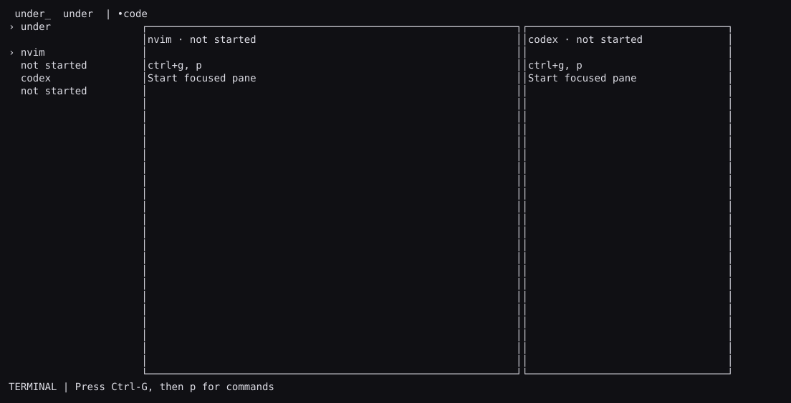

# Under

A flexible terminal IDE built around **Neovim, Yazi, Hunk and your coding agents**.

Under runs the tools you already use in real terminal panes. It adds project
workspaces, tabs, splits, a command palette and connections between those tools.
Neovim remains your editor, with your configuration and plugins.



## Install

Under is an early source distribution for macOS and Linux. Install
[Bun](https://bun.com/) 1.4.3 or newer and [Neovim](https://neovim.io/) 0.11 or newer.
Install Yazi, Hunk and agent CLIs separately when you want to use them.

```sh
git clone https://github.com/delaudio/under.git
cd under
bun install --frozen-lockfile
./under ~/projects/my-project
```

The launcher resolves its own checkout, so it also works from another directory:

```sh
/path/to/under/under ~/projects/my-project
```

To make `under` available on your PATH, create a symlink to the launcher in a
directory already on your PATH. Do not copy the launcher away from its checkout.

```sh
ln -s /path/to/under/under ~/.local/bin/under
under --help
```

## Workflow

Press **Ctrl-G**, then **p** to open the command palette. Start an agent, add a
Yazi or Hunk pane, create a tab, open a workspace, or run a configured task.
The palette can be filtered by typing. Escape closes it.

| Navigation mode key | Action                                                   |
| ------------------- | -------------------------------------------------------- |
| Ctrl-G              | Enter navigation; press again to send one literal Ctrl-G |
| Escape              | Return to the focused terminal                           |
| p                   | Command palette                                          |
| Tab / j / k         | Cycle panes                                              |
| t / w               | Next tab / workspace                                     |
| z                   | Toggle focused-pane zoom                                 |
| [ / ]               | Shrink / grow focused split                              |
| b                   | Toggle workspace sidebar                                 |
| ?                   | Shortcut help                                            |
| q                   | Save layout and quit after checking unsaved buffers      |

Ordinary keys, paste and mouse input belong to the focused tool. Application
commands require navigation mode. A modal owns input until it is dismissed.

### Layouts

- **code:** Neovim and an agent placeholder.
- **review:** Hunk and an agent placeholder.
- **run:** a shell placeholder.

Start placeholders explicitly through the palette. New tabs do not execute
commands. Tabs and hidden panes preserve running processes and terminal state.
Use splits, zoom, resizing and “Move pane to new tab” to change the layout.
On narrow terminals Under shows the focused pane; the other processes continue.

### Files and review

The palette opens files in the existing Neovim instance. In Yazi, open a text
file with its normal editor action: the per-workspace `$EDITOR` bridge opens it
in Under's Neovim. User Yazi configuration is preserved; custom opener rules
that ignore `$EDITOR` may need a user-supplied rule.

Hunk uses `hunk diff --watch`, or `hunk diff --staged --watch` for staged review.
Its editor action uses the same bridge, including the selected line. Deleted
files remain governed by Hunk's normal behavior. Custom revision reviews can be
configured as additional profiles. No global editor configuration is changed.

### Agents and context

Codex, Claude Code and OpenCode run their native interactive CLI UIs. Install and
authenticate each CLI normally. Under does not hold API keys or replace their
permission prompts. Custom agent profiles are supported.

“Preview file/selection/diagnostics context for agent” captures Neovim's live
buffer, including unsaved changes. “Preview current file diff” captures the
working-tree diff on disk. Preview shows the target agent and payload.
Enter pastes the context into that agent; **review and submit it in the native
CLI**. Under does not assume that pressing Enter has identical semantics across
providers. A changed buffer or diff invalidates the preview.

The pane status is a process state, such as `running` or `exited`. It does not
claim that a running agent is thinking, waiting for approval, or finished with
its task.

## Configuration

User settings live at `$XDG_CONFIG_HOME/under/config.json`, defaulting to
`~/.config/under/config.json`. A project can override settings in `.under.json`.
Unknown keys and invalid values produce an error message and keep valid defaults.
“Reload configuration” refreshes settings; existing processes keep their launch
arguments and environment.

```json
{
  "prefix": "ctrl+g",
  "preset": "code",
  "background": "#101014",
  "foreground": "#dddde5",
  "accent": "#b7a7e8",
  "profiles": {
    "nvim": { "argv": ["nvim"] },
    "codex": { "argv": ["codex"] },
    "claude": { "argv": ["claude"] },
    "opencode": { "argv": ["opencode"] }
  },
  "tasks": {
    "dev": { "argv": ["bun", "run", "dev"] },
    "test": { "argv": ["bun", "test"] },
    "pipeline": { "argv": ["make check && make build"], "shell": true }
  }
}
```

Tasks and agent profiles start only on an explicit action. Inspect project
configuration before starting its commands. A project override of the Neovim
command also disables automatic editor launch. Use `--no-editor` to start with
all tools stopped.

## Restore and shutdown

```sh
under --restore
```

Restore reloads layout metadata with processes stopped. Start the panes you
want explicitly. State is atomically saved to
`$XDG_STATE_HOME/under/state.json`, defaulting to
`~/.local/state/under/state.json`. It contains workspace paths, layout and
profile IDs; it does not contain prompts, buffer contents, environment secrets
or agent credentials.

Normal quit checks every owned Neovim for modified buffers and uses normal
Neovim quit. Save your changes before quitting. Signals perform forced cleanup;
Neovim's own swap-file recovery applies after crashes or forced termination.
Under only terminates process groups it launched, and preserves externally
started services and shared provider daemons.

This release does not provide a persistent server, detach/reattach, remote
access, native agent conversation APIs, or automatic provider-session resume.

## Development

```sh
bun install --frozen-lockfile
bun run check
bun run start --no-editor
```

See [architecture](docs/architecture.md), [validation](docs/validation.md) and
[the backlog](https://github.com/delaudio/under/issues).

MIT licensed.
