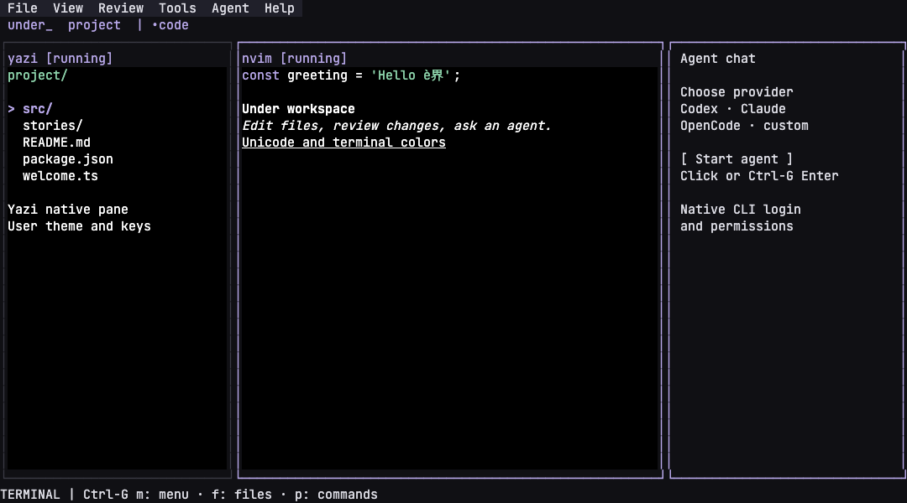

# Under

A flexible terminal IDE built around **Neovim, Yazi, Hunk and your coding agents**.

Under runs the tools you already use in real terminal panes. It adds project
workspaces, tabs, splits, a command palette and connections between those tools.
Neovim remains your editor, with your configuration and plugins.



The preview uses deterministic editor output; the application runs your real Neovim.

## Install

Under is an early source distribution for macOS and Linux. Install
[Bun](https://bun.com/) 1.4.3 or newer and [Neovim](https://neovim.io/) 0.11 or newer.
Install Yazi, Hunk and agent CLIs separately when you want to use them.

```sh
git clone https://github.com/delaudio/under.git
cd under
bun install --frozen-lockfile
./under ~/projects/my-project
```

The launcher resolves its own checkout, so it also works from another directory:

```sh
/path/to/under/under ~/projects/my-project
```

To make `under` available on your PATH, create a symlink to the launcher in a
directory already on your PATH. Do not copy the launcher away from its checkout.

```sh
ln -s /path/to/under/under ~/.local/bin/under
under --help
```

## Workflow

The default workspace shows project files on the left, Neovim in the centre,
and an agent chooser on the right. Click a file to open it in the existing
editor. Click **Start agent** to choose a provider and launch its native CLI.

The top **File / View / Review / Tools / Agent / Help** menus work with the mouse.
Press **Ctrl-G**, then **m** for keyboard menus: left/right switch menus,
up/down select, Enter activates, and Escape closes the menu. Unavailable
actions explain what needs installing or which operation is pending.

Press **Ctrl-G**, then **f** to focus native Yazi. Your theme, folder icons,
plugins and key bindings are retained. Its normal edit opener opens the file in
Under's existing Neovim. Yazi shows only the current directory, without parent or
preview columns. Use its native right/l and left/h keys to enter and leave
directories; this is directory navigation, not an expandable tree.
If Yazi is missing or stopped, a basic file list provides
arrows/j/k, Enter to open, left for parent, and r to refresh; that fallback omits
`.git`, `.under` and `node_modules`.

Open **Review → Working tree diff** or **Review → Staged diff** to start Hunk in
a dedicated tab. **Ctrl-G r** and **Ctrl-G s** do the same. Repeated actions reuse
the matching tab; the editor and its unsaved buffers stay alive.

Press **Ctrl-G**, then **p** to open the command palette. Start an agent, add a
Yazi or Hunk pane, create a tab, open a workspace, or run a configured task.
The palette can be filtered by typing. Escape closes it.

Press **Ctrl-G**, then **o** for Quick Open: type a fragment of a filename and
the ranked matches open in the existing Neovim. Ranking is by fuzzy score, and an
empty query lists the files you opened most recently first. In a Git repository
the candidates come from `git ls-files --cached --others --exclude-standard`, so
your own ignore rules decide what is offered; anywhere else a fixed skip list
(`.git`, `.under`, `node_modules`, `dist`, `build`, `target`, `.cache`, `.venv`,
`vendor`) is used and the walk is bounded.

Press **Ctrl-G**, then **g** to list every workspace and tab — including tabs
whose processes are hidden or stopped — and focus the one you choose. Focusing a
destination never restarts or reloads a tool.

| Navigation mode key | Action                                                   |
| ------------------- | -------------------------------------------------------- |
| Ctrl-G              | Enter navigation; press again to send one literal Ctrl-G |
| Escape              | Return to the focused terminal                           |
| m                   | Top menu                                                 |
| o                   | Quick open a file in this workspace                      |
| g                   | Go to a workspace or tab                                 |
| f                   | Focus native Yazi or the fallback file list                |
| r / s               | Working tree / staged diff in Hunk                        |
| l                   | Redraw all terminal panes                                 |
| p                   | Command palette                                          |
| Tab / j / k         | Cycle panes                                              |
| t / w               | Next tab / workspace                                     |
| z                   | Toggle focused-pane zoom                                 |
| [ / ]               | Shrink / grow focused split                              |
| drag a pane border  | Resize that split with the mouse                        |
| 1–9                 | Apply a layout template (see Layouts)                   |
| b                   | Toggle workspace sidebar                                 |
| ? / h               | Shortcut help                                            |
| q                   | Save layout and quit after checking unsaved buffers      |

Ordinary keys, paste and mouse input belong to the focused tool. Application
commands require navigation mode. A modal owns input until it is dismissed.
Entering navigation mode is shown in the footer as `NAV`, together with the keys
that become available, so it is clear where the next keystroke will go.

### Layouts

Layout templates rearrange the **current tab**. Press `Ctrl-G` then a digit, or
pick one from the View menu or the palette. The same templates are available as
new tabs from the File menu (**New &lt;name&gt; tab**).

| # | Template | Composition |
| --- | --- | --- |
| 1 | `chat` | chat only |
| 2 | `code` | files \| editor \| chat |
| 3 | `files-editor` | files \| editor |
| 4 | `review` | hunk \| chat |
| 5 | `files-review` | files \| hunk \| chat |
| 6 | `editor-chat` | editor \| chat |
| 7 | `editor` | editor only |
| 8 | `run` | shell only |
| 9 | `editor-chat-stack` | editor above chat |

Applying a template only **shows, hides and arranges** panes. Nothing is stopped,
restarted or reloaded, so a running chat keeps its thread and Neovim keeps its
unsaved buffers; switching to `chat` and back to `code` loses nothing. Panes a
template does not include keep running hidden. If a template needs a pane kind
the tab does not have, a stopped placeholder appears and starting stays an
explicit action.

Custom templates are declared in the user config or in a project's `.under.json`
and merged over the built-ins:

```json
{
  "templates": {
    "compose": {
      "label": "files, editor, claude",
      "panes": [
        { "kind": "yazi" },
        { "kind": "nvim" },
        { "kind": "agent", "profile": "claude" }
      ],
      "layout": {
        "axis": "row",
        "ratio": 0.3,
        "first": 0,
        "second": { "axis": "row", "ratio": 0.6, "first": 1, "second": 2 }
      },
      "focus": 1,
      "key": "c"
    }
  }
}
```

`panes` is the tab order, `layout` is the split tree with pane indexes as
leaves, `focus` is the pane that receives focus, and `key` is an optional extra
shortcut from the keys navigation does not own (`h` is reserved for the shortcut
help). A custom template may override a built-in of the same name, and
`preset` accepts a custom name as the workspace's initial layout. Invalid
definitions are reported as a warning naming the offending field.

Start stopped tools explicitly through the menus or palette; Enter also starts
a focused stopped pane. Selecting a provider reuses the idle chat pane. New tabs do not execute
commands. Tabs and hidden panes preserve running processes and terminal state.
Use splits, zoom, resizing and “Move pane to new tab” to change the layout.
Drag a pane border to resize that split; the panes on either side and their
running tools resize live, and the ratio is saved with the layout.
At 80 columns or wider the file panel appears beside the editor/chat split.
Below 80 columns it collapses; Ctrl-G f reveals it. Below 60 columns, or in a
very short terminal, Under shows the focused tool; Ctrl-G Tab switches tools.
The other processes continue. View toggles files/chat and zoom without stopping
them. Native Yazi owns Escape; use Ctrl-G Tab to return to the editor.

### Files and review

The palette opens files in the existing Neovim instance. Yazi uses a temporary
configuration directory retaining the user theme, plugins, flavors and keymap.
Its manager ratio is set to `[0, 1, 0]` and its `edit` opener uses Under's editor bridge. Other openers and
file-type rules remain configured by the user. No global Yazi files are changed.
Folder icons depend on the font selected in your host terminal.

Hunk reviews the workspace root by default. **Review this directory**,
**Review staged here** and **Review against revision…** — and `Ctrl-G r` /
`Ctrl-G s`, which use the directory the file panel is showing — scope a review to
another directory, including a worktree that lives outside the workspace, or to a
branch, tag or commit. Two revisions can be given as `from to` or `from..to`.
Each target gets its own tab and repeated actions reuse it.

Inside native Yazi, `R` reviews the directory Yazi is currently showing and `C`
reviews its staged changes; both call Under's helper and your own bindings are
kept. Hunk's editor action uses the same bridge, including the selected line.
Deleted files remain governed by Hunk's normal behavior. No global editor
configuration is changed.

### Agents and context

Codex, Claude Code and OpenCode run their native interactive CLI UIs. Install and
authenticate each CLI normally. Under does not hold API keys or replace their
permission prompts. Custom agent profiles are supported.

“Preview file/selection/diagnostics context for agent” captures Neovim's live
buffer, including unsaved changes. “Preview current file diff” captures the
working-tree diff on disk. Preview shows the target agent and payload.
Enter pastes the context into that agent; **review and submit it in the native
CLI**. Under does not assume that pressing Enter has identical semantics across
providers. A changed buffer or diff invalidates the preview.

The pane status is a process state, such as `running` or `exited`. It does not
claim that a running agent is thinking, waiting for approval, or finished with
its task.

## Configuration

User settings live at `$XDG_CONFIG_HOME/under/config.json`, defaulting to
`~/.config/under/config.json`. A project can override settings in `.under.json`.
Unknown keys and invalid values produce an error message and keep valid defaults.
“Reload configuration” refreshes settings; existing processes keep their launch
arguments and environment.

```json
{
  "prefix": "ctrl+g",
  "preset": "code",
  "background": "#101014",
  "foreground": "#dddde5",
  "accent": "#b7a7e8",
  "profiles": {
    "nvim": { "argv": ["nvim"] },
    "codex": { "argv": ["codex"] },
    "claude": { "argv": ["claude"] },
    "opencode": { "argv": ["opencode"] }
  },
  "tasks": {
    "dev": { "argv": ["bun", "run", "dev"] },
    "test": { "argv": ["bun", "test"] },
    "pipeline": { "argv": ["make check && make build"], "shell": true }
  }
}
```

Tasks and agent profiles start only on an explicit action. Inspect project
configuration before starting its commands. A project override of the Neovim
command also disables automatic editor launch. A project Yazi override requires
starting Yazi explicitly from Tools; the fallback file list remains available. Use `--no-editor` to start with
all tools stopped.

## Restore and shutdown

```sh
under --restore
```

Restore reloads layout metadata with processes stopped. Start the panes you
want explicitly. State is atomically saved to
`$XDG_STATE_HOME/under/state.json`, defaulting to
`~/.local/state/under/state.json`. It contains workspace paths, layout and
profile IDs; it does not contain prompts, buffer contents, environment secrets
or agent credentials.

Normal quit checks every owned Neovim for modified buffers and uses normal
Neovim quit. Save your changes before quitting. Signals perform forced cleanup;
Neovim's own swap-file recovery applies after crashes or forced termination.
Under only terminates process groups it launched, and preserves externally
started services and shared provider daemons.

This release does not provide a persistent server, detach/reattach, remote
access, native agent conversation APIs, or automatic provider-session resume.

## Development

```sh
bun install --frozen-lockfile
bun run check
bun run start --no-editor
```

For the browser UI catalog and screenshot checks (Node 22+ and Playwright's
Chromium are development prerequisites):

```sh
bunx playwright install chromium
bun run storybook                 # http://127.0.0.1:6006
bun run typecheck:storybook
bun run test:storybook:visual      # compare reviewed macOS baselines
bun run build-storybook
```

See [visual coverage and baseline review](storybook/COVERAGE.md).
If the launcher reports an older Bun, run `bun upgrade` before starting Under;
it refuses unsupported versions instead of risking terminal/runtime crashes.

See [architecture](docs/architecture.md), [validation](docs/validation.md) and
[the backlog](https://github.com/delaudio/under/issues).

MIT licensed.
