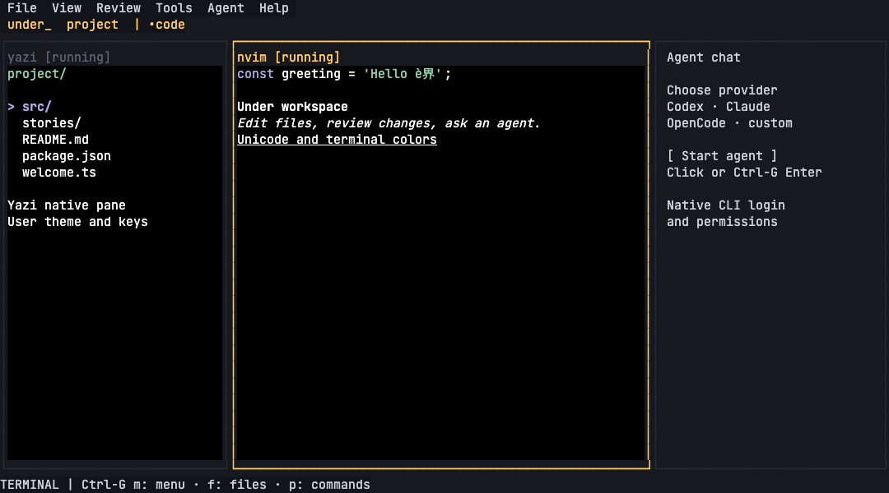

# Under

A flexible terminal IDE built around **Neovim, Yazi, Hunk and your coding agents**.

Under runs the tools you already use in real terminal panes. It adds project
workspaces, tabs, splits, a command palette and connections between those tools.
Neovim remains your editor, with your configuration and plugins.



The preview uses deterministic editor output; the application runs your real Neovim.

## Install

Under is an early source distribution for macOS and Linux. Install
[Bun](https://bun.com/) 1.4.3 or newer and [Neovim](https://neovim.io/) 0.11 or newer.
Install Yazi, Hunk and agent CLIs separately when you want to use them.

```sh
git clone https://github.com/delaudio/under.git
cd under
bun install --frozen-lockfile
./under ~/projects/my-project
```

The launcher resolves its own checkout, so it also works from another directory:

```sh
/path/to/under/under ~/projects/my-project
```

To make `under` available on your PATH, create a symlink to the launcher in a
directory already on your PATH. Do not copy the launcher away from its checkout.

```sh
ln -s /path/to/under/under ~/.local/bin/under
under --help
```

## Workflow

The default workspace shows project files on the left, Neovim in the centre,
and an agent chooser on the right. Click a file to open it in the existing
editor. Click **Start agent** to choose a provider and launch its native CLI.

The top **File / View / Review / Tools / Agent / Help** menus work with the mouse.
Press **Ctrl-G**, then **m** for keyboard menus: left/right switch menus,
up/down select, Enter activates, and Escape closes the menu. Unavailable
actions explain what needs installing or which operation is pending.

Press **Ctrl-G**, then **f** to focus native Yazi. Your theme, folder icons,
plugins and key bindings are retained. Its normal edit opener opens the file in
Under's existing Neovim. Yazi shows only the current directory, without parent or
preview columns. Use its native right/l and left/h keys to enter and leave
directories; this is directory navigation, not an expandable tree.
Moving Yazi's cursor onto a file **previews** it in Neovim while focus stays in
Yazi, as Fresh's file explorer does: scan a directory with j/k, the arrows or a
mouse click. A preview buffer is ephemeral — the next preview replaces it, so
buffers do not pile up. Editing it, or opening it with Enter (or a double
click), keeps it as a normal buffer and focuses Neovim. Buffers you already had
open, modified buffers and buffers shown in another window are never closed by
a preview. Images use the image viewer; binary files and files over 8 MB are not
previewed. Moving quickly only loads the file the cursor stops on. Previews use
a small hook placed before your `init.lua` in Under's temporary copy of it and can be
turned off with `"previewOnHover": false`.
Open files appear as **tabs** above Neovim, as in Fresh. Click a tab to show
that file (a preview tab, in italics, then stays open); click its **×**, or
middle-click the tab, to close it. A modified file shows **●** instead and is
not closed until you save or discard it. Closing a tab never closes a Neovim
window: windows showing it switch to the previous file. **Close editor tab** in
the palette closes the current one. Turn the strip off with `"editorTabs": false`.

The files panel **follows the active file**: whenever Neovim switches file —
a tab, `:e`, a jump to a definition — Yazi (or the file list) moves its cursor
to that file, opening its directory. It leaves the panel alone while you are
using it and ignores files outside the workspace. Turn it off with
`"followActiveFile": false`.

**Show/Hide hidden files** in the palette switches dotfiles in Yazi and the file
list together; it starts from your Yazi `show_hidden` setting. **Show/Hide
gitignored files** applies to the fallback file list, which hides ignored files
by default; Yazi has no gitignore filter, so it keeps showing them. Both toggles
last for the session.
If Yazi is missing or stopped, a basic file list provides
arrows/j/k (with the same previews), Enter to open, left for parent, and r to refresh; that fallback always omits
`.git`, `.under` and `node_modules`, and by default dotfiles (unless Yazi's `show_hidden` is on) and
gitignored files (see the toggles above).

PNG, JPEG, WebP and GIF files opened from Yazi, the fallback file list, Quick
Open or terminal path links appear in the Neovim pane, keeping the other panes available.
The image fits the pane; **Esc** or **Enter** returns to the editor with its
buffers preserved. Opening a text file also returns that pane to Neovim.
You can switch to files or agents while the image stays visible.
Use **+ / -** or the **mouse wheel** to zoom (up to 8× the fitted size),
**arrow keys / h j k l** or **drag** to pan, and **0 / f** to fit and centre
again. Zoom and pan stay clipped to the editor pane.
Press **a** to switch between pan and annotation mode. In annotation mode,
**drag** to draw red rectangles. Drag inside an existing rectangle to move it;
**Shift-drag** draws a new rectangle even over an existing one. Rectangles stay
inside the image when moved. Press **u** to remove the last rectangle.
Press **c** to copy an annotated PNG to the system clipboard, then use the
agent client's image-paste action. On macOS this uses the native clipboard;
Linux requires `wl-copy` (Wayland) or `xclip` (X11). Image pasting depends on
the agent client. **p** exports a PNG and copies its local path via the terminal
clipboard, for agents that can read image files. Over SSH, use the path option
with an agent on that same host.

Annotations only exist in the viewer and disappear when the image is closed or
replaced. Copies contain the full image at its original resolution, regardless
of zoom/pan, and never overwrite the source. Each copy is saved under the system
temporary directory as `under-annotation-*/annotated.png`; it remains available
after closing Under until the OS cleans temporary files. Export supports images
up to 16 million pixels. Nothing is submitted to an agent automatically.

Under uses the terminal's graphics support when available, with a coloured-block
fallback otherwise. GIF previews are static. Other recognised raster formats
show an error if the decoder does not support them. The explicit **Open file in
Neovim** command remains available to open a file as text.

Open **Review → Working tree diff** or **Review → Staged diff** to start Hunk in
a dedicated tab. **Ctrl-G r** and **Ctrl-G s** do the same. Repeated actions reuse
the matching tab; the editor and its unsaved buffers stay alive.

Press **Ctrl-G**, then **p** to open the command palette. Start an agent, add a
Yazi or Hunk pane, create a tab, open a workspace, or run a configured task.
The palette can be filtered by typing. Escape closes it.

Press **Ctrl-G**, then **o** for Quick Open: type a fragment of a filename and
the ranked matches open in the existing Neovim. Ranking is by fuzzy score, and an
empty query lists the files you opened most recently first. In a Git repository
the candidates come from `git ls-files --cached --others --exclude-standard`, so
your own ignore rules decide what is offered; anywhere else a fixed skip list
(`.git`, `.under`, `node_modules`, `dist`, `build`, `target`, `.cache`, `.venv`,
`vendor`) is used and the walk is bounded.

Press **Ctrl-G**, then **g** to list every workspace and tab — including tabs
whose processes are hidden or stopped — and focus the one you choose. Focusing a
destination never restarts or reloads a tool.

| Navigation mode key | Action                                                   |
| ------------------- | -------------------------------------------------------- |
| Ctrl-G              | Enter navigation; press again to send one literal Ctrl-G |
| Escape              | Return to the focused terminal                           |
| m                   | Top menu                                                 |
| o                   | Quick open a file in this workspace                      |
| g                   | Go to a workspace or tab                                 |
| f                   | Focus native Yazi or the fallback file list                |
| r / s               | Working tree / staged diff in Hunk                        |
| l                   | Redraw all terminal panes                                 |
| p                   | Command palette                                          |
| Tab / Shift-Tab / j / k | Cycle panes                                              |
| t / w               | Next tab / workspace                                     |
| z                   | Toggle focused-pane zoom                                 |
| [ / ]               | Shrink / grow focused split                              |
| drag a pane border  | Resize that split with the mouse                        |
| 0–9                 | Apply a layout template (see Layouts)                   |
| b                   | Toggle workspace sidebar                                 |
| ? / h               | Shortcut help                                            |
| q                   | Save layout and quit after checking unsaved buffers      |

**Ctrl+Left / Ctrl+Right** switch directly to the previous/next pane without
Ctrl-G, ready to type. These keys are reserved by Under; other key combinations
belong to the focused tool. On macOS, disable the matching Mission Control
shortcuts in System Settings if they intercept these keys.

Other application commands require navigation mode. A modal owns input until it is dismissed.
Entering navigation mode is shown in the footer as `NAV`, together with the keys
that become available, so it is clear where the next keystroke will go.

### Layouts

Layout templates rearrange the **current tab**. Press `Ctrl-G` then a digit, or
pick one from the View menu or the palette. The same templates are available as
new tabs from the File menu (**New &lt;name&gt; tab**).

| # | Template | Composition |
| --- | --- | --- |
| 1 | `chat` | chat only |
| 2 | `code` | files \| editor \| chat |
| 3 | `files-editor` | files \| editor |
| 4 | `review` | hunk \| chat |
| 5 | `files-review` | files \| hunk \| chat |
| 6 | `editor-chat` | editor \| chat |
| 7 | `editor` | editor only |
| 8 | `run` | terminal only |
| 9 | `editor-chat-stack` | editor above chat |
| 0 | `chat-shell` | chat above a free terminal |

Applying a template only **shows, hides and arranges** panes. Nothing is stopped,
restarted or reloaded, so a running chat keeps its thread and Neovim keeps its
unsaved buffers; switching to `chat` and back to `code` loses nothing. Panes a
template does not include keep running hidden. If a template needs a pane kind
the tab does not have, a stopped placeholder appears and starting stays an
explicit action.

Custom templates are declared in the user config or in a project's `.under.json`
and merged over the built-ins:

```json
{
  "templates": {
    "compose": {
      "label": "files, editor, claude",
      "panes": [
        { "kind": "yazi" },
        { "kind": "nvim" },
        { "kind": "agent", "profile": "claude" }
      ],
      "layout": {
        "axis": "row",
        "ratio": 0.3,
        "first": 0,
        "second": { "axis": "row", "ratio": 0.6, "first": 1, "second": 2 }
      },
      "focus": 1,
      "key": "c"
    }
  }
}
```

`panes` is the tab order, `layout` is the split tree with pane indexes as
leaves, `focus` is the pane that receives focus, and `key` is an optional extra
shortcut from the keys navigation does not own (`h` is reserved for the shortcut
help). A custom template may override a built-in of the same name, and
`preset` accepts a custom name as the workspace's initial layout. Invalid
definitions are reported as a warning naming the offending field.

Start stopped tools explicitly through the menus or palette; Enter also starts
a focused stopped pane. Selecting a provider reuses the idle chat pane. New tabs do not execute
commands. Tabs and hidden panes preserve running processes and terminal state.
Use splits, zoom, resizing and “Move pane to new tab” to change the layout.
Drag a pane border to resize that split; the panes on either side and their
running tools resize live, and the ratio is saved with the layout.
At 80 columns or wider the file panel appears beside the editor/chat split.
Below 80 columns it collapses; Ctrl-G f reveals it. Below 60 columns, or in a
very short terminal, Under shows the focused tool; Ctrl-G Tab switches tools.
The other processes continue. View toggles files/chat and zoom without stopping
them. Native Yazi owns Escape; use Ctrl-G Tab to return to the editor.

### Files and review

The palette opens files in the existing Neovim instance. Yazi uses a temporary
configuration directory retaining the user theme, plugins, flavors and keymap.
Its manager ratio is set to `[0, 1, 0]` and its `edit` opener uses Under's editor bridge. Other openers and
file-type rules remain configured by the user. No global Yazi files are changed.
Folder icons depend on the font selected in your host terminal.

Hunk reviews the workspace root by default. **Review this directory**,
**Review staged here** and **Review against revision…** — and `Ctrl-G r` /
`Ctrl-G s`, which use the directory the file panel is showing — scope a review to
another directory, including a worktree that lives outside the workspace, or to a
branch, tag or commit. Two revisions can be given as `from to` or `from..to`.
Each target gets its own tab and repeated actions reuse it.

Inside native Yazi, `R` reviews the directory Yazi is currently showing and `C`
reviews its staged changes; both call Under's helper and your own bindings are
kept. Hunk's editor action uses the same bridge, including the selected line.
Deleted files remain governed by Hunk's normal behavior. No global editor
configuration is changed.

### Choosing the review tool

Review actions use **Hunk** by default. They can use
[herdr-reviewr](https://github.com/persiyanov/herdr-reviewr) instead, run as a
plain terminal app (`herdr plugin install persiyanov/herdr-reviewr` puts
`herdr-reviewr` on your PATH). Set `"reviewTool": "reviewr"` to make it the
default, or pick **Review tool: Hunk / reviewr** in the Review menu for the
session; **Working tree diff in reviewr** and **… in Hunk** open either one
directly.

reviewr shows the working tree against `HEAD` and lets you comment on lines.
**Review against revision…** passes the revision as its `--base` (press `b` for
its branch scope). It has no staged scope and diffs against one base, so staged
reviews and `from..to` ranges still open in Hunk, with a note in the status line.
Its **Send** needs herdr itself, so inside Under press `y` to copy your comments
and paste them into the agent; `e` opens the line in Under's Neovim. When Under
runs inside herdr, Under hides herdr's pane identity from reviewr so it never
sends to a pane outside Under.

### Worktrees

**Open a worktree…** lists the current repository's checkouts — the primary one,
linked worktrees and detached HEAD checkouts — with their branch and how to reach
them, and marks the ones already open. Choosing one opens it as its own workspace,
or focuses it when it is already open, and starts no tool. A directory that no
longer exists, a locked entry and a bare repository are listed with the reason
they cannot be opened. Discovery runs only `git worktree list`, is bounded in time
and size, and re-reads Git on every request, so worktrees created or removed
outside Under appear immediately. Folders outside Git keep working as plain
workspaces.

### Agents and context

Codex, Claude Code and OpenCode run their native interactive CLI UIs. Install and
authenticate each CLI normally. Under does not hold API keys or replace their
permission prompts. Custom agent profiles are supported.

“Preview file/selection/diagnostics context for agent” captures Neovim's live
buffer, including unsaved changes. “Preview current file diff” captures the
working-tree diff on disk. When more than one agent is running in the workspace
you choose the destination first; the list names each agent by provider, pane and
tab so repeated profiles stay distinguishable. Preview then shows the chosen
destination and the exact payload. Enter pastes the context into that agent and
focuses its tab; **review and submit it in the native CLI**. Under does not
assume that pressing Enter has identical semantics across providers. A changed
buffer or diff invalidates the preview, and an agent that exited or was replaced
requires a new choice rather than silently receiving the payload somewhere else.
The choice is remembered per workspace for as long as that agent is running.

The pane status is a process state, such as `running` or `exited`. It does not
claim that a running agent is thinking, waiting for approval, or finished with
its task.

## Configuration

User settings live at `$XDG_CONFIG_HOME/under/config.json`, defaulting to
`~/.config/under/config.json`. A project can override settings in `.under.json`.
Unknown keys and invalid values produce an error message and keep valid defaults.
“Reload configuration” refreshes settings; existing processes keep their launch
arguments and environment.

```json
{
  "prefix": "ctrl+g",
  "preset": "code",
  "theme": "flat",
  "editorTheme": false,
  "previewOnHover": true,
  "followActiveFile": true,
  "editorTabs": true,
  "reviewTool": "hunk",
  "profiles": {
    "nvim": { "argv": ["nvim"] },
    "codex": { "argv": ["codex"] },
    "claude": { "argv": ["claude"] },
    "opencode": { "argv": ["opencode"] }
  },
  "tasks": {
    "dev": { "argv": ["bun", "run", "dev"] },
    "test": { "argv": ["bun", "test"] },
    "pipeline": { "argv": ["make check && make build"], "shell": true }
  }
}
```

`theme` picks Under's own colours: `flat` (default; dark panels told apart by
shade, warm yellow focus, modelled on the flat theme of
[Fresh](https://github.com/sinelaw/fresh)) or `classic` (the earlier violet
accent). `background`, `foreground` and `accent` (`#RRGGBB`) override single
colours of the theme. Embedded tools keep their own colours. Set
`"editorTheme": true` to also switch Neovim to the matching `under-flat`
colour scheme after your configuration loads; otherwise it is only made
available, and `:colorscheme under-flat` applies it by hand.

Tasks and agent profiles start only on an explicit action. Inspect project
configuration before starting its commands. A project override of the Neovim
command also disables automatic editor launch. A project Yazi override requires
starting Yazi explicitly from Tools; the fallback file list remains available. Use `--no-editor` to start with
all tools stopped.

## Restore and shutdown

```sh
under --restore
```

Restore reloads layout metadata with processes stopped. Start the panes you
want explicitly. State is atomically saved to
`$XDG_STATE_HOME/under/state.json`, defaulting to
`~/.local/state/under/state.json`. It contains workspace paths, layout and
profile IDs; it does not contain prompts, buffer contents, environment secrets
or agent credentials.

Normal quit checks every owned Neovim for modified buffers and uses normal
Neovim quit. Save your changes before quitting. Signals perform forced cleanup;
Neovim's own swap-file recovery applies after crashes or forced termination.
Under only terminates process groups it launched, and preserves externally
started services and shared provider daemons.

This release does not provide a persistent server, detach/reattach, remote
access, native agent conversation APIs, or automatic provider-session resume.

## Development

```sh
bun install --frozen-lockfile
bun run check
bun run start --no-editor
```

For the browser UI catalog and screenshot checks (Node 22+ and Playwright's
Chromium are development prerequisites):

```sh
bunx playwright install chromium
bun run storybook                 # http://127.0.0.1:6006
bun run typecheck:storybook
bun run test:storybook:visual      # compare reviewed macOS baselines
bun run build-storybook
```

See [visual coverage and baseline review](storybook/COVERAGE.md).
If the launcher reports an older Bun, run `bun upgrade` before starting Under;
it refuses unsupported versions instead of risking terminal/runtime crashes.

See [architecture](docs/architecture.md), [validation](docs/validation.md) and
[the backlog](https://github.com/delaudio/under/issues).

MIT licensed.
